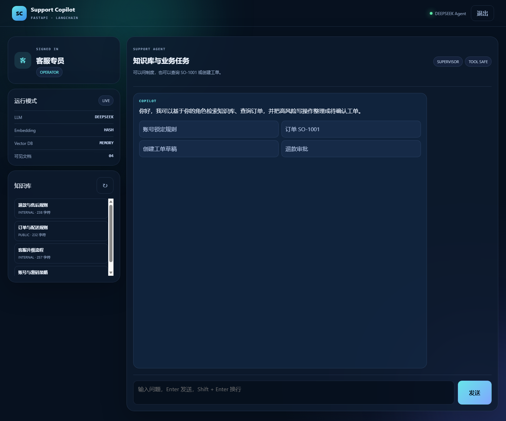

# AI Support Copilot

一个用于 AI 应用开发求职展示的 Python 全栈项目：

**FastAPI + LangChain 1.x + RAG + Tool Calling + SSE + SQLite + Docker + 自动评测**



项目面向企业客服场景：用户可以查询知识库、查询订单，并让 Agent 准备工单草稿。
正式工单必须由用户再次确认，模型不能绕过角色权限和业务校验。

## 功能

- FastAPI REST + SSE；配置模型后使用 LangChain Token 级流式输出
- 内置管理员、客服专员、只读用户三种角色
- HMAC 签名 Token、接口权限和文档可见范围
- LangChain `RecursiveCharacterTextSplitter` 文档切分
- 离线哈希 Embedding 或可选 OpenAI Embedding
- LangChain `InMemoryVectorStore` 向量检索
- 向量相似度 + 关键词重叠的混合重排
- LangChain 1.x `create_agent` 与 `@tool` 工具调用
- 订单状态查询工具
- 工单草稿工具 + 人工确认 + 数据库幂等
- 对话历史、消息持久化、操作审计
- 10 条固定 RAG 检索评测
- 21 个自动化测试、Ruff 检查和 GitHub Actions
- Docker Compose、一键启动脚本

## 架构

```text
Browser
  -> FastAPI (REST / SSE)
  -> Auth + Role Guard
  -> RAG Retriever
       -> LangChain TextSplitter
       -> Hash / OpenAI Embeddings
       -> InMemoryVectorStore
       -> Visibility Filter + Hybrid Rerank
  -> LangChain Agent
       -> query_order_status
       -> prepare_support_ticket
  -> SQLite
       -> documents / conversations / messages
       -> ticket_drafts / tickets
       -> audit_logs
```

模型只负责理解意图和选择工具，确定性代码负责：

- 身份和角色校验；
- 文档可见范围；
- 订单权限；
- 工单草稿、正式确认和幂等；
- 提示词注入边界；
- 模型失败时降级到本地规则。

## 快速开始

要求 Python 3.12+，推荐 Python 3.13。

```powershell
cd D:\codexTest\CodexModleTest\ai-support-copilot
python -m venv .venv
.\.venv\Scripts\python.exe -m pip install -e ".[dev]"
powershell -ExecutionPolicy Bypass -File .\scripts\run-dev.ps1
```

打开：

- Web 控制台：`http://127.0.0.1:8000/`
- Swagger：`http://127.0.0.1:8000/docs`
- 健康检查：`http://127.0.0.1:8000/health`

演示账号：

| 账号 | 密码 | 能力 |
|---|---|---|
| `viewer` | `viewer123` | 检索公开知识，不能查询订单或创建工单 |
| `operator` | `operator123` | 检索公开/内部知识、查询订单、准备工单草稿 |
| `admin` | `admin123` | 全部权限、文档管理、审计和 RAG 评测 |

演示账号仅用于本地展示，生产环境必须接入正式身份系统。

## 离线模式与真实模型

不配置任何 Key 时，项目仍可完整运行：

- 使用确定性哈希 Embedding；
- 使用本地规则完成订单、工单和知识库路由；
- 所有 API、权限、持久化和 UI 均可验证。

接入 OpenAI-Compatible 模型：

```powershell
Copy-Item .env.example .env
```

编辑 `.env`：

```dotenv
APP_SECRET=至少32位随机字符串
LLM_API_KEY=你的模型Key
LLM_BASE_URL=https://api.openai.com/v1
LLM_MODEL=gpt-4o-mini

EMBEDDING_API_KEY=你的EmbeddingKey
EMBEDDING_BASE_URL=https://api.openai.com/v1
EMBEDDING_MODEL=text-embedding-3-small
```

配置 `LLM_API_KEY` 后，聊天会切换到 LangChain `create_agent`。模型调用失败时自动降级为
`local-rule-fallback`，不会把异常直接暴露给前端。

## 主要接口

```text
POST /api/v1/auth/login
GET  /api/v1/auth/me

GET  /api/v1/documents
POST /api/v1/documents/upload
POST /api/v1/documents/text
DELETE /api/v1/documents/{id}

POST /api/v1/chat
POST /api/v1/chat/stream

GET  /api/v1/orders/{orderId}
POST /api/v1/tickets/drafts
POST /api/v1/tickets/{draftId}/confirm

GET  /api/v1/evaluations/rag
GET  /api/v1/admin/audit-logs
GET  /api/v1/runtime
```

示例：

```powershell
$login = Invoke-RestMethod -Method Post `
  -Uri 'http://127.0.0.1:8000/api/v1/auth/login' `
  -ContentType 'application/json' `
  -Body '{"username":"operator","password":"operator123"}'

$headers = @{ Authorization = "Bearer $($login.access_token)" }

Invoke-RestMethod -Method Post `
  -Uri 'http://127.0.0.1:8000/api/v1/chat' `
  -Headers $headers `
  -ContentType 'application/json' `
  -Body '{"query":"查询订单 SO-1001 的物流状态"}'
```

## Docker

```powershell
Copy-Item .env.example .env
docker compose up --build -d
docker compose ps
```

数据持久化在 `./data/support_copilot.db`。

## 测试

```powershell
.\.venv\Scripts\pytest.exe
.\.venv\Scripts\ruff.exe check app tests
```

测试覆盖：

- 登录、Token 和未认证访问；
- 三种角色与文档可见范围；
- 文档上传、格式校验和删除；
- RAG 检索、引用和评测；
- 订单工具权限；
- 工单草稿、确认和幂等；
- SSE 事件；
- 会话隔离和审计日志。

## 项目边界

- 订单数据是本地模拟数据；
- SQLite 适合单实例作品集，不适合直接作为高并发生产部署；
- 默认向量索引在启动时构建，生产应切换 pgvector、Qdrant 或 Milvus；
- HMAC Token 和演示账号用于说明认证边界，生产应接入 OIDC/OAuth2；
- 离线模式按固定消息块推送；配置真实模型后使用 LangChain `astream_events` 推送模型 Token；
- 没有实现多 Agent 自由协作，当前单 Agent + 工具更符合这个业务规模。

详细设计见 [docs/architecture.md](docs/architecture.md)，验证记录见
[docs/verification.md](docs/verification.md)，面试与简历表述见
[docs/interview-guide.md](docs/interview-guide.md)。
